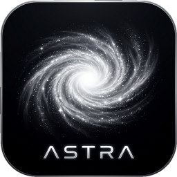

  
  <h1 align="center">Astra</h1>
  <h4 align="center">A self-hosted game stream host for Moonlight.</h4>

## ℹ️ About

Astra is a self-hosted game stream host for Moonlight. It captures your desktop,
encodes it with low latency, and serves it to any Moonlight-compatible client on
your local network or over the internet. A web UI handles configuration, pairing,
and troubleshooting from a browser.

Astra is the host counterpart to [SoLunar](https://github.com/aldokeita/SoLunar),
an Android client built for using a desktop from a phone. Any other Moonlight
client works too.

## ✨ Features

- Low-latency streaming with hardware encoding on AMD, Intel, and Nvidia GPUs, plus software encoding.
- Web UI for configuration, application management, pairing, and diagnostics, available in English and Bahasa Indonesia.
- HDR, AV1, HEVC, and 10-bit streaming support where the hardware allows it.
- Virtual gamepad, pen, and touch input passthrough.
- Multi-monitor friendly: run one instance per display with its own port, config, and pairing state.

## 🧭 Built for SoLunar

SoLunar expects the standard Moonlight protocol and a host that is ready out of the
box. Astra keeps that protocol untouched: default ports, mDNS service type, config
format, and state files stay compatible with existing Moonlight hosts and clients.

> The binary, package, and systemd unit are still named `sunshine` on purpose.
> That keeps existing installs, configs, and pairings working while Astra is under
> development. Renaming them is a separate decision for a future release.

## 🛠️ Building

Build requirements and platform-specific steps are documented in
[docs/building.md](docs/building.md). On Arch-based distributions, a PKGBUILD for
the fork is available at [packaging/linux/Arch/PKGBUILD.astra](packaging/linux/Arch/PKGBUILD.astra).

## 🎨 Branding

- Black night sky, white constellation lines, and starlight accents.
- The `Astra` theme is the default in a clean browser. All upstream UI themes remain selectable.
- Interface languages: English (default) and Bahasa Indonesia.

## 📄 License

Astra is free software, licensed under the GNU General Public License v3.0. See
[LICENSE](LICENSE) and [NOTICE](NOTICE) for the full text and third-party notices.
